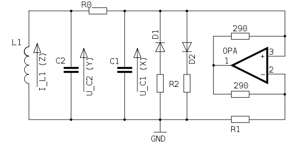

# chuap

Simulates Chua's oscillator, an LRC oscillator with an active resistor, proved capable of bifurcation and chaotic attractors, with k-rate control of circuit elements.

## Description

Simulates Chua's oscillator, an LRC oscillator with an active resistor, proved capable of bifurcation and chaotic attractors, with k-rate control of circuit elements.

## Syntax

``` text
aI3, aV2, aV1 chuap kL, kR0, kC2, kG, kGa, kGb, kE, kC1, iI3, iV2, iV1, ktime_step
```

## Initialization

*iI3* -- Initial current at G

*iV2* -- Initial voltage at C2

*iV1* -- Initial voltage at C1

## Performance

*kL* -- Inductor L (L1 in the diagram)

*kR0* -- Resistor R0 (R0 in the diagram)

*kC1* -- Capacitor C1

*kC2* -- Capacitor C2

*kG* -- Resistor G (part of the active resistor, R1 in the diagram). The G parameter is the time step, which is needed to get the same slope of the piecewise discontinuity from Ga and Gb for all sampling rates.

*kGa* -- Resistor V (nonlinearity term of the active resistor, one of the R2's in the diagram)

*kGb* -- Resistor V (nonlinearity term of the active resistor, one of the R2's in the diagram)

*kE* -- Size of the piecewise discontinuity simulating the active resistor

*ktime_step* -- Delta time in the difference equation, can be used to more or less control pitch.

*Chua's oscillator* is a simple LRC oscillator with an active resistor. The oscillator can be driven into period bifurcation, and thus to chaos, because of the nonlinear response of the active resistor.



The circuit is described by a set of three ordinary differential equations called Chua's equations:

``` text
dI3/dt = -(R0/L) * I3 - V2/L
dV2/dt = I3/C2 - (G/C2) * (V2 - V1)
dV1/dt = (G/C1) * (V2 - V1) - f(V1)/C1
```

where f() is the piecewise function that models the active resistor:

``` text
f(V1) = Gb * V1 + 0.5 * (Ga - Gb) * (abs(V1 + E) - abs(V1 - E))
```

A solution of these equations (I3,V2,V1)(t) starting from an initial state (I3,V2,V1)(0) is called a trajectory of Chua's oscillator. The Csound implementation is a difference equation simulation of Chua's oscillator with Runge-Kutta integration.

> **Note**
> This algorithm uses internal non linear feedback loops which causes audio result to depend on the orchestra sampling rate. For example, if you develop a project with *sr*=48000Hz and if you want to produce an audio CD from it, you should record a file with *sr*=48000Hz and then downsample the file to 44100Hz using the [src_conv](../utility/src_conv.md) utility.

> **Warning**
> Some parameter settings produce amplitude spikes or positive feedback that could damage speakers.

## Examples

Here is an example of the chuap opcode. It uses the file [chuap.csd](../examples/chuap.csd).

``` csound-csd
--8<-- "examples/chuap.csd"
```

## See Also

[Models and Emulations](../siggen/models.md)

## Credits

Inventor of Chua's oscillator: [Leon O. Chua](http://www.eecs.berkeley.edu/~chua), Author of MATLAB simulation: James Patrick McEvoy [MATLAB Adventures in Bifurcations and Chaos (ABC++)](http://www.mathworks.com/matlabcentral/fileexchange/loadFile.do?objectId=3541), Author of Csound port: Michael Gogins

New in Csound version 5.09

Note added by François Pinot, August 2009
